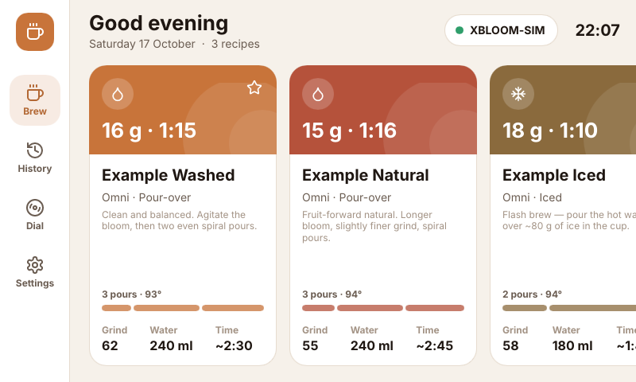
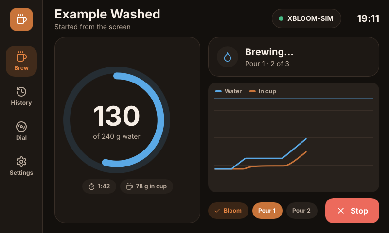
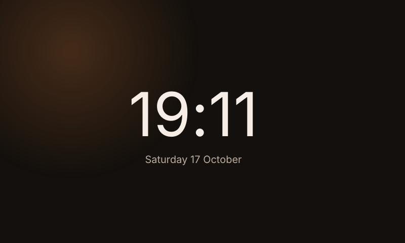
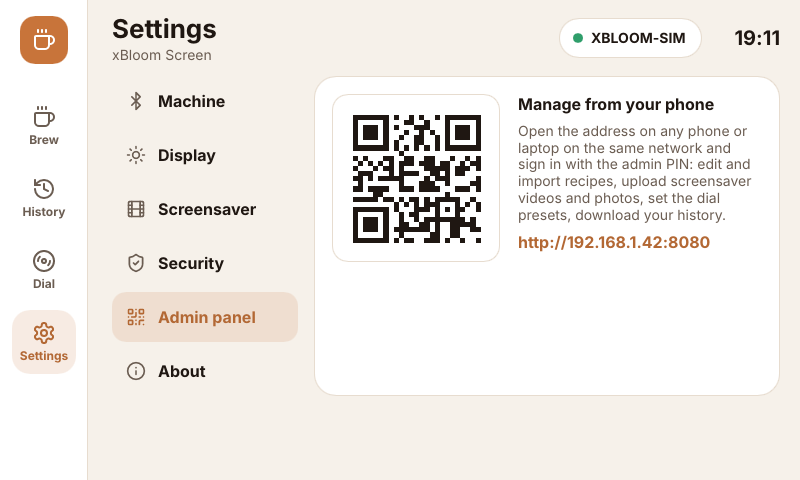
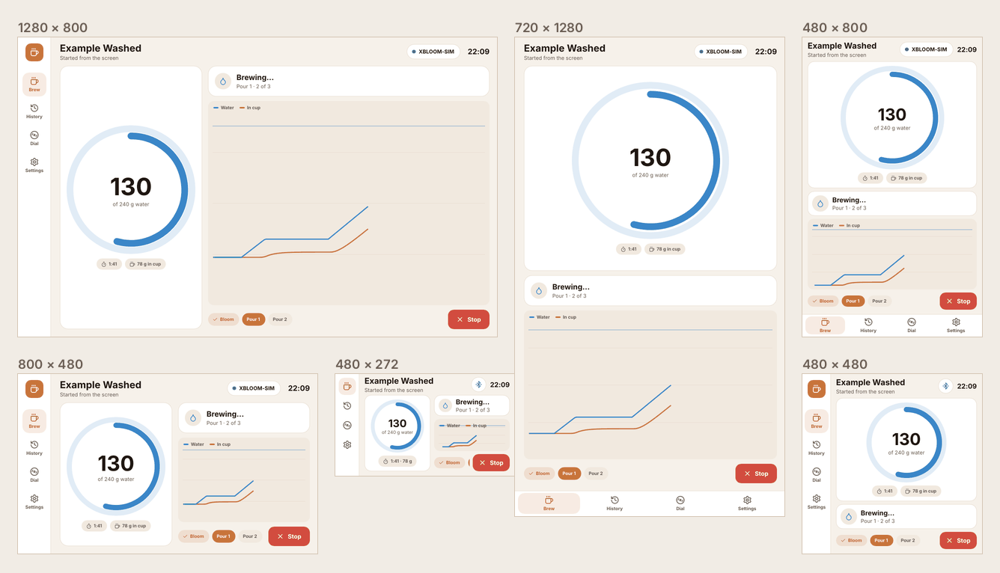
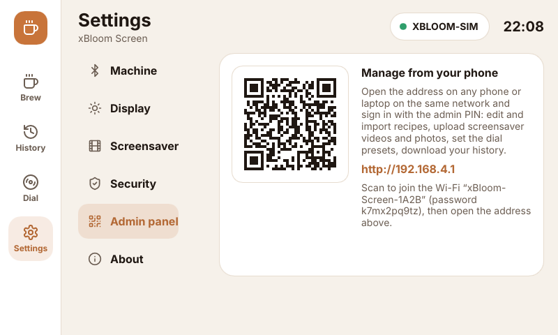

# xBloom Screen

A touchscreen controller for the **xBloom Studio** pour-over machine. It runs next to the
machine on a **Raspberry Pi with a touchscreen** or on an **ESP32-S3 touch display**, and
comes with a web **admin panel** for your phone. It builds on the reverse-engineered
Bluetooth protocol documented in this repository's [main README](../README.md).

| Home | Brewing |
| --- | --- |
|  |  |
| **Screensaver** | **Settings → Admin panel** |
|  |  |

More screens are in [`docs/img/screen/`](../docs/img/screen/), most in light and dark. They
are rendered from the real app driving the built-in simulated machine.

**Download:** the [releases page](https://github.com/uaepro/xbloom-screen/releases) has the
Raspberry Pi build and the ESP32-S3 image. What changed is in [CHANGELOG.md](CHANGELOG.md).

> Unofficial: this project is not affiliated with or endorsed by xBloom.

## What it does

**On the screen**
- **Recipe library**: swipe through your recipes and tap one to see its pours, grind,
  temperature and water. **Load** sends it to the machine and arms it; then press start on
  the machine. Optionally, **Hold to brew** starts it from the screen (see Safety below).
- **Live brew view**: progress ring, a water / in-cup chart, the current pour and a **Stop**
  button.
- **Dial presets**: program the machine's three Easy-Mode dial presets from any recipes.
- **History**: every brew with its curve, ratio and time.
- **Lock**: off, PIN to brew, or PIN for the whole screen. There is an optional separate user
  PIN, and the screen locks again after it has been idle.
- **Screensaver**: a clock, a video or a photo slideshow, with dimming, and the screen
  switches off after a longer idle period.
- **Appearance**: light, dark or automatic (dark at night), six accent colours, brightness,
  interface size.
- **Any screen**: the layout adapts to panels from 480 × 272 up to large HDMI screens, in
  landscape or portrait (see [Screen sizes](#screen-sizes-and-orientation)).
- **Setup wizard**: set an admin PIN, pair the machine, then scan the QR code to open the
  admin panel.
- **Demo mode**: a built-in simulated machine, so you can try everything without coffee.

**In the admin panel** (any phone or laptop on the same network, signed in with the admin
PIN):
- Create and edit recipes with live validation against the machine's limits. You can also
  import and export the YAML format of the `xbloom` CLI, or reorder and hide recipes.
- Program the dial presets and push them to the machine.
- Upload screensaver videos and photos. Videos are converted **in your browser** to the
  screen's own format, so the device never needs a video decoder.
- View brew history with charts, and export it as CSV.
- Change every setting: lock and PINs, remote start, appearance, screensaver, machine pairing,
  Wi-Fi and time zone (ESP32), backup and restore, restart.

## 🛑 Safety

This app has the same safety rule as the rest of the repository: **loading a recipe only
arms the machine; it never starts a brew.**

- **Load** sends only the LOAD frames. After that you either press start on the machine, or…
- **Hold to brew** (on by default, can be turned off in the settings) is the only way the
  screen starts a brew. It is a deliberate press-and-hold gesture (1.2 s by default,
  adjustable). If a brew lock is set, it asks for the PIN first.
- The admin panel's API **has no brew-start endpoint at all**. From the network you can load
  recipes, program presets and **stop** a brew, but never start one.
- **Stop** (on the screen and in the panel) cancels a running brew.

## Hardware

### Raspberry Pi (recommended)

| | |
| --- | --- |
| Board | Raspberry Pi Zero 2 W, 3B+, 4 or 5 with built-in Bluetooth |
| OS | Raspberry Pi OS Lite **64-bit** (Bookworm or newer); no desktop needed |
| Display | Any DSI or HDMI touchscreen, 480 × 272 or larger, landscape or portrait. See [Screen sizes](#screen-sizes-and-orientation) |

The app draws straight to the display through DRM/KMS and reads touch through libinput, so
it needs no X11, Wayland or browser.

### ESP32-S3 (experimental)

Two boards are supported, each with its own firmware. Both run from USB-C, 5 V, and need an
ESP32-S3 module with 8 MB PSRAM and 16 MB or 8 MB flash. The code on the module's metal
shield says which: **N16R8** (16 MB flash) or **N8R8** (8 MB). Pick the image for both your
board and that code:

| Board | Screen | Image (`xbloom-screen-esp32s3-…`) |
| --- | --- | --- |
| Sunton **ESP32-8048S043C** | 4.3" 800 × 480 IPS, GT911 capacitive touch, dimmable backlight | `…-sunton-8048s043c-16mb.bin` / `…-8mb.bin` |
| Waveshare **ESP32-S3-Touch-LCD-7** | 7" 800 × 480, GT911 capacitive touch, backlight on/off only | `…-waveshare-touch-lcd-7-16mb.bin` / `…-8mb.bin` |

With 8 MB of flash the data partition is about 1.9 MB instead of 8.9 MB: plenty for
recipes, history and photos, and screensaver videos up to 10 s (30 s with 16 MB). An image
for 16 MB doesn't start on an 8 MB module (the boot log says "Detected size(8192k) smaller
than the size in the binary image header"); flash the `-8mb` one.

On the Waveshare board the backlight can only be switched on and off, so **Brightness** and
the screensaver's dimming step have no effect; the screen still turns off when it sleeps.
The Waveshare ESP32-S3-Touch-LCD-**7B** (1024 × 600) is a different board and needs its own
entry.

> ⚠️ The ESP32 firmware compiles in CI from the same code as the Pi app, but **it has not yet
> been tested on real hardware**. The pin maps and panel timings come from the vendors'
> board configurations. If you try it, please open an issue with what you see. Other
> RGB-panel ESP32-S3 boards need one board entry in
> [`firmware/esp32s3/src/board.rs`](firmware/esp32s3/src/board.rs).

On the ESP32, recipes, history and media live on a flash partition of ~8.9 MB (16 MB
flash) or ~1.9 MB (8 MB). Screensaver videos are converted at half resolution (400 × 240,
10 fps, up to 30 s, or 10 s with 8 MB flash) and scaled up on the screen.

**Other ESP32 boards.** The firmware needs an ESP32-**S3** with 8 MB PSRAM, 8 or 16 MB flash
and a parallel-RGB panel. The classic ESP32 (ESP-WROOM-32 modules, "Cheap Yellow Display"
boards) has no PSRAM and no RGB LCD controller, and usually 4 MB of flash, less than the
firmware image alone. It is not supported (see the [roadmap](../ROADMAP.md) for a possible
headless build).

## Screen sizes and orientation

The UI is designed at 800 × 480 (the official 7" Pi display and the common 4.3"–7" ESP32-S3
boards) and lays itself out again for other panels instead of stretching:



| Screen | Layout |
| --- | --- |
| **Short** (480 × 272, 480 × 320) | Slim header, icon-only navigation rail, smaller type. Panels stay side by side, trimmed to their controls: the brew panel keeps Hold to brew and Load only, and the PIN dialog puts the keypad beside its heading |
| **Regular** (800 × 480, 1024 × 600) | The reference layout. Recipes scroll in a row at 800 × 480 and form a two-row grid from 1024 × 600 |
| **Large** (1280 × 800 and up) | More grid columns, a bigger progress ring and clock |
| **Portrait** (480 × 800, 720 × 1280) and **square** (480 × 480) | Navigation moves to a bottom tab bar, and panels stack: the brew controls are pinned under the recipe, the ring sits over the chart |

Whatever the size, the brew controls and the **Stop** button stay on screen, and dialogs
always fit inside it.

**Interface size** (Settings → Display, or the admin panel) makes text and controls bigger
or smaller, from 70 % to 200 %. Use it for dense panels, such as a 5" 720 × 1280 or a 10"
1920 × 1080. It is capped so the layout never gets smaller than 480 × 272.

**Rotation** (0°, 90°, 180° or 270°, clockwise) turns both the picture and the touch input,
for a panel mounted on its side or upside down. The app restarts to apply it. It is offered
on the kiosk Pi and on the ESP32; a desktop rotates its own windows. On the Pi, a
`SLINT_KMS_ROTATION` line in the systemd service (there's a commented example in it)
overrides the setting. A touch calibration set in udev (`LIBINPUT_CALIBRATION_MATRIX`) is
kept, with the rotation applied on top of it. If a rotation leaves the screen hard to use,
change it back from the admin panel.

## Install

### Raspberry Pi

On the Pi, as root:

```bash
curl -fsSL https://raw.githubusercontent.com/uaepro/xbloom-screen/main/screen/deploy/install.sh | sudo bash
```

The installer:

1. installs BlueZ and a few runtime libraries;
2. downloads the latest build (`screen-latest`);
3. creates an unprivileged `xbloom` service user;
4. installs a systemd service that starts the screen at boot, and a udev rule so the app can
   dim the backlight.

Options go after `bash -s --`:

| Option | |
| --- | --- |
| `--tag screen-vX.Y.Z` | install a specific release instead of the latest build |
| `--binary PATH` | install a binary you built yourself |
| `--from-source` | build on the Pi (Pi 4/5; takes a while) |
| `--port N` | admin panel port (default 80) |
| `--uninstall` | remove the service (your data in `/var/lib/xbloom-screen` is kept) |

Logs: `journalctl -u xbloom-screen -f`.

### ESP32-S3

1. Download the image for your board and flash size (see the
   [table above](#esp32-s3-experimental)) from a
   [release](https://github.com/uaepro/xbloom-screen/releases) (or the
   [latest build of `main`](https://github.com/uaepro/xbloom-screen/releases/tag/screen-latest)).
   The boards' images aren't interchangeable: each one drives its own board's pins.
2. Flash it **at address 0x0**. It's a merged image with the bootloader, partition table
   and app. You can use [Espressif's web flasher](https://espressif.github.io/esptool-js/)
   in Chrome/Edge, or from a terminal:
   ```bash
   espflash write-bin 0x0 xbloom-screen-esp32s3-waveshare-touch-lcd-7-8mb.bin
   ```
   The image ends before the data partition, so flashing an update keeps your recipes,
   history and settings. Don't tick "erase flash" unless you want a factory reset. If the
   computer doesn't see the board, hold **BOOT** while you plug it in.
3. On first boot the screen asks for an admin PIN and offers to pair the machine. Then go to
   **Settings → Admin panel**: until it has Wi-Fi credentials, the screen hosts its own
   network called `xBloom-Screen-XXXX`. The password is shown there, together with a QR code
   that joins it. Once you join, your phone opens the admin panel (at `http://192.168.4.1`);
   enter your home Wi-Fi under **Settings → Wi-Fi & clock**.

   

The hotspot always uses WPA2 with a random password unique to each device, so nobody nearby
can get to the panel before you set your PIN. It comes back by itself if your Wi-Fi is down
for more than 45 seconds.

## First run

1. **Admin PIN** (4–8 digits): it protects the settings and the admin panel.
2. **Pair**: turn the machine on, tap **Scan**, then pick your `XBLOOM…`. Or choose **Try
   demo mode**.
3. **Done**: scan the QR code with your phone to open the admin panel.

## The admin panel and security

The panel is served by the device itself, on your local network, at the address shown under
**Settings → Admin panel** on the screen.

- PINs are stored as salted PBKDF2-SHA256 hashes and are never sent back by the API.
- Wrong PINs are throttled: after 5 attempts there is a 30 s wait, and the wait doubles each
  time up to 15 min. The screen and the web panel are throttled separately.
- Sessions use an `HttpOnly`, `SameSite=Strict` cookie. Every change also needs a custom
  header (CSRF protection), and the panel ships with a strict Content-Security-Policy.
- The panel uses plain HTTP (there's no way to get a trusted certificate for a LAN
  appliance), so use it on a network you trust.

## Architecture

```
screen/
├── crates/
│   ├── xbloom-core     protocol frames, recipes + validation, telemetry, brew monitor,
│   │                   machine driver, simulated machine — no_std core, no I/O
│   ├── xbloom-app      settings, PIN lock, recipe/history/preset/media stores, the machine
│   │                   controller thread, and the platform-independent admin HTTP API
│   ├── xbloom-ui       the Slint touchscreen UI (ui/*.slint) and its glue to the app
│   └── xbloom-screen   Raspberry Pi / Linux binary: BlueZ (btleplug), tiny_http, DRM/KMS
├── firmware/esp32s3    ESP32-S3 firmware: RGB panel, GT911 touch, NimBLE, Wi-Fi, FAT
├── admin/              the web admin panel (plain JS/CSS), gzipped into the binary
├── deploy/             installer, systemd unit, backlight udev rule
└── tools/gen_golden.py golden test vectors from the Python reference
```

Both targets run **the same code**: protocol, app logic, API, UI and admin panel. Each
target only adds its own hardware glue: a Bluetooth transport, an HTTP server adapter, and
hooks for the display, backlight and storage.

**One UI for every screen.** Components size themselves from the `Layout` global
(`crates/xbloom-ui/ui/layout.slint`). It derives size classes (short, narrow, portrait,
large) and layout measures from the window, after the interface-size setting. A test
(`crates/xbloom-ui/tests/fit.rs`) lays the UI out at 12 panel sizes and fails if the brew
buttons, Stop, the PIN keypads or the setup button leave the screen or get too small to
tap.

**Byte-for-byte parity with the Python package.** `tools/gen_golden.py` runs the Python
reference (`xbloom_ble`, whose frames were checked against real captures) over a broad set
of recipes. It records every frame, CRC, telemetry decode and validation message. The Rust
tests then assert identical bytes and identical error text, and CI fails if the vectors
drift.

### Why Rust + Slint

The goals were to run on small hardware, start instantly, feel fluid, and use one codebase
for both a Pi and a microcontroller:

- **A web app in a kiosk browser** would need Chromium: hundreds of MB of RAM, slow to boot
  on a Pi Zero 2 W, and impossible on an ESP32. So the web is used only where it shines: the
  admin panel on your phone.
- **Rust** compiles to one small static binary for both targets, with no runtime or garbage
  collector. The memory safety matters for an appliance that runs for months.
- **[Slint](https://slint.dev)** is a declarative UI toolkit built for embedded touchscreens.
  Its software renderer draws exactly the same pixels on a Pi as on an ESP32, and only
  redraws what changed. It needs no GPU, and offscreen rendering gives the screenshots above.

### Licences

This project's source is **MIT**. The bundled **Inter** font is under the SIL Open Font
License and the **Lucide** icons are under the ISC license (see `crates/xbloom-ui/ui/`).

**Slint** offers GPLv3, a royalty-free licence (desktop, mobile and web apps only) or a
commercial licence. A dedicated touchscreen appliance is an *embedded* use, so the built
binaries use Slint under **GPLv3**. The complete source is right here, so personal and
open-source use is fine. To ship this inside a closed-source commercial product, you would
need a Slint commercial licence.

## Development

```bash
cd screen
cargo test --workspace                       # all tests, incl. the screen-size test (no hardware)
cargo run -p xbloom-screen -- --demo         # run in a desktop window, simulated machine
                                             # admin panel on http://localhost:8080
cargo run -p xbloom-ui --example screenshots --features screenshot -- ../docs/img/screen
# the same at another panel size and interface scale, light theme only:
cargo run -p xbloom-ui --example screenshots --features screenshot -- /tmp/shots 480x320 quick
cargo run -p xbloom-ui --example screenshots --features screenshot -- /tmp/shots 1920x1080@1.5 quick
python3 tools/gen_golden.py                  # after a protocol change in xbloom_ble
```

On a desktop Linux build you need: `libudev-dev libinput-dev libxkbcommon-dev
libfontconfig-dev libdbus-1-dev pkg-config`.

**ESP32-S3 firmware.** It needs the Xtensa Rust toolchain from
[`espup`](https://github.com/esp-rs/espup), version **1.98.1.0** (1.97 hits an Xtensa LLVM
bug on float selects; 1.99's `std` doesn't build for ESP-IDF), and ESP-IDF v5.5.6, which is
fetched automatically on the first build.

```bash
espup install --targets esp32s3 --toolchain-version 1.98.1.0
cargo install ldproxy espflash
. ~/export-esp.sh
cd screen/firmware/esp32s3
cargo build --release    # Sunton ESP32-8048S043C, the default board
# or: cargo build --release --no-default-features --features board-waveshare-s3-touch-lcd-7
espflash flash --monitor target/xtensa-esp32s3-espidf/release/xbloom-screen-esp32s3
# 8 MB flash: add --flash-size 8mb --partition-table partitions-8mb.csv
```

**Releases.** CI checks and builds both targets on every pull request and push to `main`.
Pushes to `main` update the rolling `screen-latest` pre-release; a `screen-vX.Y.Z` tag makes a
versioned release (see [docs/RELEASING.md](../docs/RELEASING.md#xbloom-screen-releases)).
