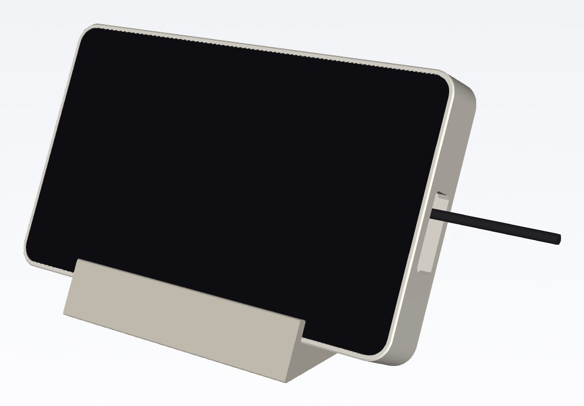
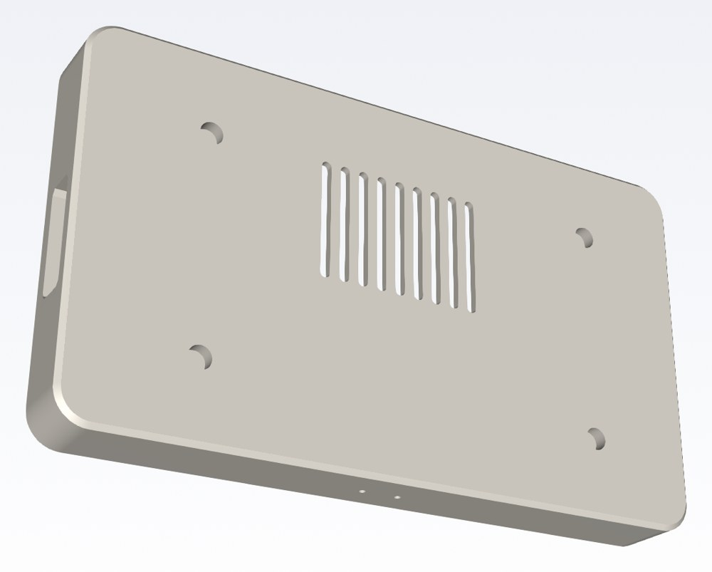
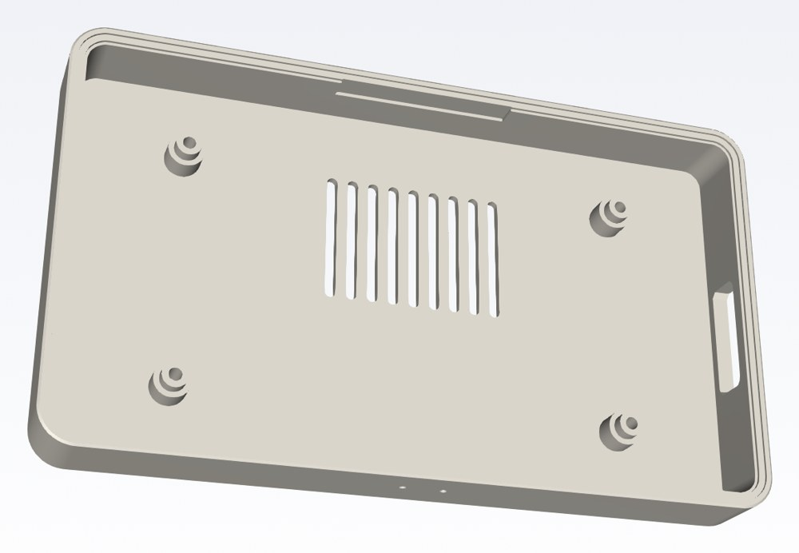
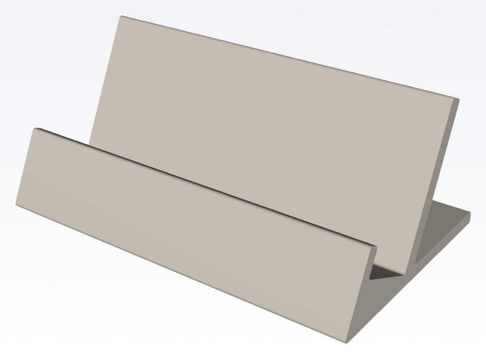
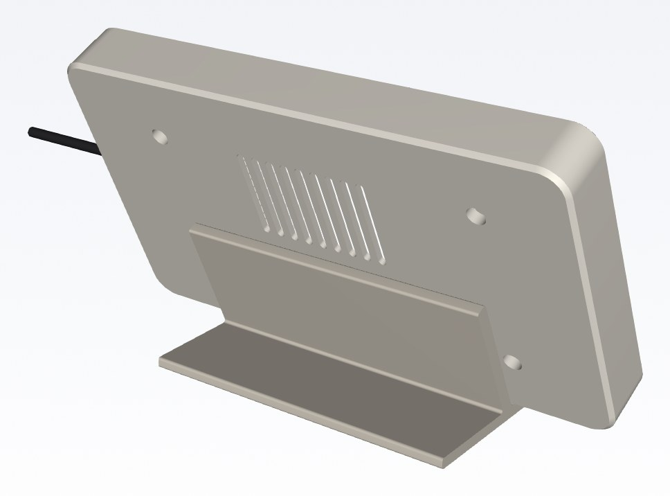
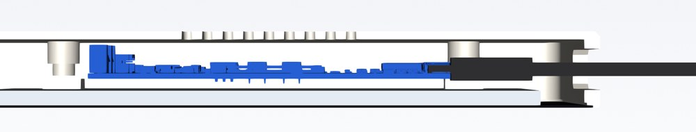

# Back case and stand for the Waveshare ESP32-S3-Touch-LCD-7

The Waveshare 7" board comes as a bare cover glass with the LCD and the driver board stuck
to its back. This is a 3D-printable back case for it, plus a desk stand. The USB-C ports
stay usable with the case closed.



- **Back case**: the glass drops into a pocket, so its edges are covered. Four M3 screws
  go into the brass inserts on the back of the LCD. A window in the side wall lines up with
  both USB-C ports (`UART1` and `USB`), so a straight USB-C cable plugs straight in. There
  are vents in the back and pin holes for **RESET** and **BOOT** in the bottom edge.
- **Stand**: a cradle that holds the screen leaning back at 65°. The case just sits in it,
  so you can lift the screen out. It works either way up (see [Which way up](#which-way-up)).
- **Fit test**: the USB end of the case only, to check the fit before the full print.

> ⚠️ **Not printed yet.** The design comes from Waveshare's drawings and 3D model and has
> been checked in CAD and in a slicer, but it hasn't been fitted to a real board. Do the
> [checks below](#before-you-print-the-whole-case) and print the fit test first.

| Back | Inside (front view, without the screen) |
| --- | --- |
|  |  |
| **The stand** | **On the stand, from behind** |
|  |  |

## What you need

| | |
| --- | --- |
| Prints | [`stl/back-case.stl`](stl/back-case.stl), [`stl/stand.stl`](stl/stand.stl), and first [`stl/fit-test.stl`](stl/fit-test.stl) |
| Screws | 4 × **M3 × 12 mm**, socket head (ISO 4762) or button head (ISO 7380). **Not longer** (see below) |
| Cable | A USB-C cable with a **straight** plug whose moulded body is at most 14.8 × 9.5 mm (most are 12–13 × 6.5–8 mm) |
| Optional | 4 stick-on rubber feet, up to 10 mm across, for the stand |
| Printer | A bed of at least 200 × 120 mm (the case is 197.5 × 115.3 × 22.4 mm) |

> 🛑 **Use M3 × 12 screws, no longer.** The screw heads sit deep in the case so that a 12 mm
> screw goes 2.2 mm into the insert and its tip stops about 1 mm short of the LCD's metal
> back. A longer screw can press on the back of the panel and damage it. Tighten the
> screws gently: the inserts are small.

## Printing

All three parts print **without supports**. The STL files are already turned the right way
for printing: the case lies on its back, the stand on its base.

| Part | Size (mm) | Filament (PETG) | Time (PrusaSlicer estimate) |
| --- | --- | --- | --- |
| Back case | 197.5 × 115.3 × 22.4 | ≈ 102 g | ≈ 10 h |
| Stand | 120 × 75 × 49 | ≈ 62 g | ≈ 5 h |
| Fit test | 59 × 115 × 22.4 | ≈ 34 g | ≈ 3 h |

The estimates are PrusaSlicer 2.7's at its default (slow) speeds. A modern fast printer
takes a fraction of that.

- **PETG** is the better choice next to a coffee machine (heat and steam). PLA is fine
  away from it.
- 0.4 mm nozzle, 0.2 mm layers, 3 walls, 15 % infill.
- Each screw hole has a 0.3 mm skin at the bottom of the head bore, so the slicer can bridge
  it. Push the screw through it, or open it with a 3 mm drill bit by hand.

## Before you print the whole case

1. **Check the board revision.** It's printed on the driver board next to "800×480
   Pixels". The case is made for **Rev1.2**. Another revision may have its USB ports
   elsewhere.
2. **Measure the inserts.** Lay the screen face down on a table and measure from the table
   to the top of one brass insert. The case expects **8.3 mm**. If yours differs by more
   than 0.5 mm, change `INSERT_TOP_Z` in [`case.py`](case.py) and rebuild the files (see
   [Changing the design](#changing-the-design)).
3. **Print the fit test.** Put the USB end of the screen into it and fit the two screws.
   Check that the glass sits flat in the pocket, the screws grip, and a USB-C cable plugs
   into both ports through the window. You can see the ports through the window.

## Assembly

1. Lay the screen face down on a soft cloth.
2. Lower the case onto it, back up, with the cable window on the same side as the USB
   ports. The glass drops into the pocket.
3. Fit the four M3 × 12 screws. Tighten them until the case sits on the glass, no more.
4. Push the cable through the window into either USB-C port. Both power the board, and
   both can flash it.
5. Stand the screen in the stand, bottom edge in the slot. The bottom edge is the one with
   the two pin holes.

The pin holes in the bottom edge reach the **BOOT** (left, seen from the front) and
**RESET** (right) buttons: press them with a paper clip. Flashing doesn't normally need
them (`espflash` resets the board itself), but they help if a flash goes wrong.

## Which way up

The case and the stand work either way up. Upright, as designed, the panel's flex cables
are at the top and the cable comes out on the **right** side, seen from the front. If the
picture is upside down, set **Settings → Display → Rotation** to 180°. You can also turn
the screen over in the stand, so the cable leaves on the left.

## Changing the design

Everything is generated by [`case.py`](case.py) with [CadQuery](https://cadquery.readthedocs.io).
The parameters at the top are in millimetres: wall and frame sizes, screw length, window,
vents, and the stand's angle and size. Run it to rebuild the STL files, plus STEP files in
[`step/`](step/) for editing in Fusion, FreeCAD, Onshape and similar:

```bash
pip install cadquery
python3 case.py                   # rebuild stl/ and step/
python3 case.py --check           # also run the clearance checks
python3 case.py --check board.stp # and check against Waveshare's 3D model of the board
```

The 3D model is `esp32-s3-touch-lcd-7.stp` in the "3D drawing" zip on
[Waveshare's wiki page](https://www.waveshare.com/wiki/ESP32-S3-Touch-LCD-7). It isn't in
this repo.

`--check` fails if the case touches the glass, the LCD, the insert blocks or any of the
board's 833 parts. It also fails if a USB-C plug can't go in through the window, if a
screw tip comes within 0.5 mm of the LCD, if the case doesn't fit the stand, or if the
stand covers the vents. For the current design it reports:

```
LCD to the case: 2.82 mm
post ends to the inserts: 1.00 mm
M3 × 12: 2.2 mm into the insert, tip 1.10 mm above the LCD back
UART1: a 14.8 × 9.5 mm plug fits
USB: a 14.8 × 9.5 mm plug fits
driver board: 833 parts, the closest 1.60 mm from the case
stand: centre of mass 46 mm behind the toe, 30 mm in front of the heel
```



## Where the dimensions come from

| What | Value | Source |
| --- | --- | --- |
| Cover glass | 192.96 × 110.76 mm, corners R7.8 | Waveshare's drawing (PDF in the 3D drawing zip) and wiki |
| Glass + LCD | 5.00 mm | drawing |
| M3 inserts | 126.20 × 65.65 mm apart; 31.85 / 21.58 mm from the glass edges | drawing |
| Driver board, USB-C ports, buttons, tallest part (18.4 mm from the glass front) | | Waveshare's STEP model (Rev 1.2 layout) |
| Where the board sits | its holes 29.10 / 5.80 mm from the inserts; 15.44 / 19.3 mm from its edges | drawing. The wiki's back-view picture puts the 5.80 mm label on the wrong side; the product photos agree with the drawing |
| Top of the inserts | ≈ 8.3 mm from the glass front | measured off the drawing's side view. **Check yours** |
| Glass thickness | 0.7 mm assumed | not on the drawing. A thicker glass only sits a little proud of the frame and keeps the screws further from the LCD |

The pictures are renders of the CAD model, with a simplified glass, LCD and cable. The
cut-away also shows Waveshare's model of the driver board.
